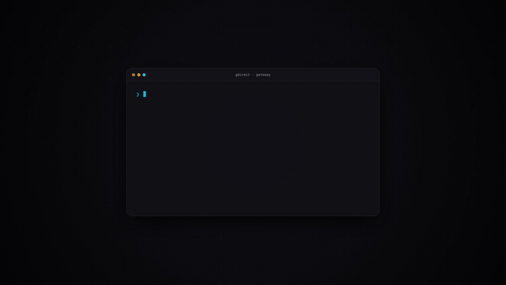

# gdirect · High-Performance Google Drive Streaming Gateway & Transfer Engine

[中文说明](README.zh-CN.md) · [Releases & Prebuilts](https://github.com/GentlemanHu/gdirect/releases) · [Changelog](CHANGELOG.md) · [Documentation](文件说明.md)

<p align="center">
  
</p>

gdirect is an advanced Google Drive streaming gateway and high-throughput transfer system. By scanning, benchmarking, and binding reachable Google edge frontend IP addresses (with built-in TLS SNI identity forging), it routes petabyte-scale Drive traffic directly over optimal edge endpoints, fully saturating physical local bandwidth without censorship throttling.

Engineered specifically for cloud media streaming and multi-device access, gdirect integrates an embedded React 19 single-page administration console, a cinema-grade dual-subtitle video player, native WebDAV 302/206 streaming, and Emby/Jellyfin `.strm` zero-disk playback.

---

## Key Features

- ⚡ **HTTP 206 Partial Content Streaming Gateway**: Full random seeking support with millisecond-level response; reads MP4 `moov` and MKV `cues` index chunks on demand for instantaneous time-to-first-frame.
- 💾 **Zero-Disk RAM Ring-Buffer Prefetching**: Configurable 8MB–512MB RAM sliding window per streaming session. Eliminates local disk wear and storage exhaustion; instantly cancels stale chunks on seeks.
- 🎬 **Cinema-Grade Native Video Player**:
  - **Comprehensive Subtitle Engine**: Built-in ASS/SSA/SRT/VTT parser with empty-field tolerance and style tag stripping; dual-subtitle concurrent rendering (primary + secondary) with bilingual line splitting;
  - **Embedded Track Sniffing**: Native detection of container text tracks (`textTracks`) with seamless 1-click external player handoff (VLC, Infuse, IINA, MX Player, PotPlayer, VidHub);
  - **6-Mode Aspect Ratio Scaling**: Defaults to `Contain` (native uncropped ratio with adaptive borders); supports fast cycle (`C` key) through `Cover` (center-cropped), `Fill`, `16:9`, `4:3`, and `21:9`;
  - **Silent Network Reconnection & Autoplay**: Resilient `safePlay` autoplay policy; automatically recovers playback from memory timestamps within 2s of network reconnection or gateway reload.
- 📁 **Multi-Protocol & Zero-Disk Media Library Mounting**:
  - **WebDAV (RFC 4918)**: Supports HTTP 302 redirect mode (recommended for OpenList, direct streaming from gateway without intermediate proxying) and 206 Range direct streaming;
  - **Emby / Jellyfin `.strm` Generator**: Recursively scans entire cloud folders to package lightweight `.strm` ZIP archives, enabling full poster scraping and 4K playback without downloading files.
- 🌐 **Multi-Engine Route Dispatching**:
  - `Direct`: Direct edge connection via domestic Google frontends; zero VPN traffic consumed;
  - `Official 302`: Redirects to official Google Drive download URLs for clients with proxies;
  - `Proxy`: Routes streaming through a local gateway proxy.
- 📦 **Dual-Variant Multi-Platform Release Matrix**:
  - Every release publishes both **Full Edition (with embedded React 19 Web Console)** and **CLI Edition (headless, ultra-lightweight)**;
  - Platforms: Linux x86_64, macOS Apple Silicon (M-series), macOS Intel, Windows x86_64, Android ARM64-v8a, and Android ARMv7-a.

---

## Quick Start

### 1. Docker Compose (Recommended)

```bash
curl -fsSL https://raw.githubusercontent.com/GentlemanHu/gdirect/main/docker-compose.yml -o docker-compose.yml
docker compose up -d
```
Access the web management console at `http://<server-ip>:8080`.

### 2. Android Phone / TV Box via Termux

On Android devices running Termux (ARM64 / ARMv7):
```bash
# Download latest Android static binary
curl -fL https://github.com/GentlemanHu/gdirect/releases/latest/download/gdirect-0.9.0-aarch64-linux-android.tar.gz | tar -xz
chmod +x gdirect

# Start streaming gateway
./gdirect serve --host 0.0.0.0 --port 8090
```

### 3. Standalone Host Run (Linux / macOS / Windows)

Download precompiled binaries from [GitHub Releases](https://github.com/GentlemanHu/gdirect/releases), or run directly:
```bash
# Start streaming gateway and web console (default port 8080)
./gdirect serve --port 8080

# Run with Master API Key authentication
./gdirect serve --port 8080 --api-key my-secure-token
```

---

## Client & Media Integrations

### 1. OpenList Configuration (WebDAV 302 Zero-Relay)
- **Driver**: `WebDAV`
- **WebDAV URL**: `http://<gateway-ip>:<port>/webdav/`
- **Web Proxy**: **Turn OFF** (Disabling proxy activates 302 direct redirect, ensuring video streams directly to browser/client without double-hop).
- **Credentials**: Any username/password if `--api-key` is omitted.

### 2. Emby / Jellyfin Zero-Disk Library (.strm)
1. In gdirect Web Console, navigate to **Integrations** &rarr; **Emby / Jellyfin**;
2. Provide the folder ID (default `root`) and public gateway URL, then download the `.strm` library ZIP;
3. Extract into your Emby media path and enable "Direct Play", achieving instant 5TB media wall scraping without local disk consumption.

### 3. 1-Click External Player Launching
From the video player, click **External Player** to deep-link streams into:
- **iOS / macOS**: Infuse (`infuse://`), IINA (`iina://`), VLC (`vlc://`)
- **Android**: MX Player (`intent://`), nPlayer (`nplayer-http://`)
- **Windows**: PotPlayer (`potplayer://`), VLC

---

## Build from Source

### 1. Frontend Build
```bash
cd web
npm install
npm run build
```

### 2. Backend Compilation
```bash
# Full Edition (with embedded Web Console)
cargo build --release

# CLI-only Edition (Headless, ultra-small binary)
cargo build --release --no-default-features
```

### 3. Android Cross-Compilation
Configure your Android NDK toolchain in `.cargo/config.toml`:
```bash
cargo ndk --target aarch64-linux-android --platform 24 build --release --bin gdirect
```

---

## License

This project is licensed under the [GPL-2.0-or-later](LICENSE).
